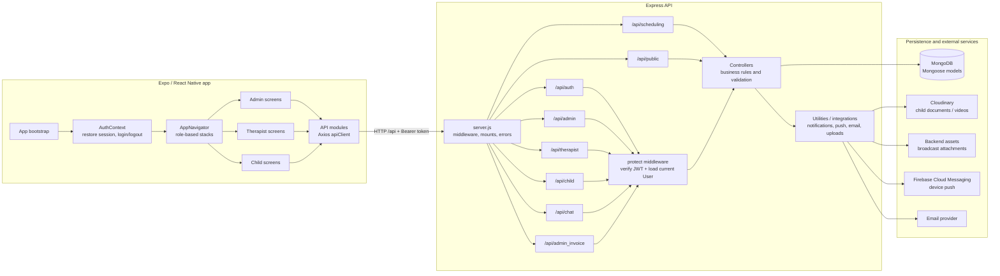
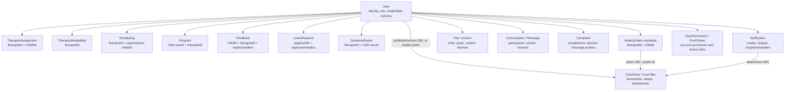

# Healers system flow and user data lifecycle

This document maps the current React Native frontend and Express/Mongoose backend, then describes what currently happens when an account is made inactive or deleted and what should be retained or removed. It is based on the source code, not a live database inspection.

> Batch feature flows are intentionally omitted. Batch-specific checks that currently block account changes are mentioned only where they affect the user lifecycle.

## 1. End-to-end application flow



### Request lifecycle

1. A screen calls a feature API module in `Healers/src/api/`.
2. `apiClient.js` adds the stored `jwt_token` as a Bearer token and sends the request to the configured API host.
3. Express dispatches to the route mounted in `Backend/server.js`.
4. Protected routes use `protect`: it verifies the JWT, loads the current `User`, and rejects missing, deleted, or inactive accounts. The controller applies the feature operation.
5. Controllers read/write Mongoose models and, where needed, invoke storage, push-notification, or email services.
6. API data returns to the screen. A `401` clears persisted auth data in the client.

The route groups live in `Backend/routes/`; feature logic lives in `Backend/controllers/`; schemas and relationships live in `Backend/models/`.

## 2. Sign-in, session and role flow

```mermaid
sequenceDiagram
  participant App as React Native app
  participant Store as AsyncStorage
  participant Auth as /api/auth
  participant DB as MongoDB User
  participant Guard as protect middleware
  participant Feature as Feature controller

  App->>Store: Restore jwt_token + user_info
  alt No valid saved token
    App->>Auth: POST /login (email/phone + password)
    Auth->>DB: Find user; require isActive=true
    DB-->>Auth: User record
    Auth-->>App: JWT + public user fields + permissions
    App->>Store: Save session
  end
  App->>App: AppNavigator selects Admin, Therapist, or Child stack
  App->>Guard: Feature request + Bearer JWT
  Guard->>DB: Verify token subject still exists and is active
  DB-->>Guard: Current user
  Guard->>Feature: Attach current user and continue
  Feature-->>App: Feature response
  App->>Auth: Logout cleanup (online status / push token)
  App->>Store: Clear saved auth data
```

- User roles in the backend schema are `Admin`, `Manager`, `Therapist`, `Parent`, and `Child`. The current navigator defines Admin, Therapist, and Child stacks; there is no separate Manager or Parent stack in `AppNavigator.js`.
- Managers use permission groups and permissions; their permission membership is stored separately in `UserPermission`.
- Admin impersonation of a Child or Therapist uses a short-lived read-only token. It is not a separate user record.
- The backend checks the user record on protected requests, so marking an account inactive blocks its existing token on the next protected API request; it does not wait for JWT expiry. It does not by itself clear the token from the device.

## 3. Feature map (batch flows excluded)

| Frontend area | Main work | Backend entry points / data |
|---|---|---|
| Authentication and profile | Register/login, forgot/reset password, profile, online status, push registration | `/api/auth`; `authController`; `User`, `PushToken` |
| Admin dashboard and account administration | Overview, users, admins/managers, therapists, children, permissions | `/api/admin`, `/api/auth`; `adminController`, `CommonController`, permission handlers; `User`, `TherapistAssignment`, `UserPermission` |
| Scheduling and attendance | Therapist availability, appointments, child/therapist schedules, attendance reports | `/api/admin`, `/api/scheduling`, `/api/therapist`, `/api/child`; `Scheduling`, `TherapistAvailability`, `LeaveRequest` |
| Programs and progress | Assignments, goals, progress, child session statistics | `/api/therapist`, `/api/admin`; `Program`, `TherapistAssignment`, `Scheduling` |
| Feedback and reports | Child/therapist feedback, replies, visibility, quarterly reports | `/api/child`, `/api/therapist`, `/api/admin`; `Feedback`, `QuarterlyReport` |
| Leave | Submit, review, approve/reject, staff-on-leave view | `/api/therapist`, `/api/admin`; `LeaveRequest` |
| Videos | Upload video to Cloudinary, save metadata, share with assigned children | `/api/therapist`, `/api/child`; `WeeklyVideo` |
| Messaging | Conversations, messages, unread/read state | `/api/chat`; `Conversation`, `Message` |
| Complaints | Child/therapist complaint and replies; admin resolution/priority | `/api/child`, `/api/admin`; `Complaint` |
| Invoices and fees | Child invoices, payment entries, fee details | `/api/admin_invoice`, `/api/admin`; `Invoice`, `Fee` |
| Notifications and broadcasts | In-app notifications, recipient/read state, push sends, attachments | `/api/admin`, `/api/auth`; `Notification`, `PushToken`; Firebase and local broadcast files |
| Packages, services and settings | Configure packages/services and clinic hours/settings | `/api/admin`, `/api/public`; `Package`, `Service`, `SystemSetting` |

## 4. User-linked data map

`User` is the account record and central identity. Other collections use its MongoDB `_id`; Mongoose references do not automatically cascade when a `User` is deleted.



### What those references contain

- **Clinical and care history:** `Scheduling` stores therapist appointments, child attendees, and attendance; `Program` stores therapist-authored child goals; `Feedback` and `QuarterlyReport` store observations and progress.
- **Staff operations:** `TherapistAssignment` connects therapists to children; `TherapistAvailability` stores recurring or date-specific availability; `LeaveRequest` stores requests and decisions.
- **Communications:** `Conversation` stores participants and per-user deletion state; `Message` stores sender, receiver and text. `Complaint` stores complainant, resolution, and embedded replies.
- **Financial records:** `Fee` references a child and therapist. `Invoice` references a child, optional parent, creator, and payment receiver; it also contains invoice items and payment history.
- **Notifications/devices:** `Notification` stores who created it, its target users/recipients and read state. Device tokens are stored in the separate `PushToken` collection. `User` also has a `pushTokens` array for a legacy token path.
- **Permissions and authorship:** `UserPermission` links a Manager to permission groups and records who assigned the group. `Package` and `Role` have a `createdBy` user reference.
- **Media:** child documents are represented by Cloudinary URLs/public IDs embedded in `User.documents`; weekly videos have Cloudinary URLs/public IDs in `WeeklyVideo`. Broadcast attachments are files under `Backend/assets/broadcasts` and referenced by notifications.
- **Parent relationship:** a Child account stores `fatherName` and `fatherCnic` directly, rather than a parent-user foreign key. Invoices can separately have an optional `parentId`.

## 5. Current deactivate/delete behavior

| Account | Deactivate today | Delete today |
|---|---|---|
| Admin | `PUT /api/admin/admins/:id` sets `User.isActive=false`; self-deactivation is rejected. Login and protected requests then reject the account. No related records or device tokens are cleaned up. | `DELETE /api/admin/admins/:id` deletes only the `User` document; self-delete and deleting the last Admin are rejected. References such as notification authors/readers are not cascaded. |
| Manager | `PUT /api/admin/manager/:id` sets `isActive=false`; self-deactivation is rejected. It does not remove permission-group assignments or device tokens. | `DELETE /api/admin/manager/:id` deletes only the `User` document; self-delete and deleting the last Manager are rejected. `UserPermission` rows and other references are not cascaded. |
| Therapist | `PUT /api/admin/therapists/:id` blocks deactivation while the therapist is in a currently running batch. Otherwise it removes future non-batch appointments from `Scheduling`, keeps past and batch-linked appointments, and sets `isActive=false`. It leaves assignments, availability, programs, feedback, reports, media, and push tokens in place. | `DELETE /api/admin/therapists/:id` refuses a currently running batch. If past appointment or batch history exists, it removes future non-batch appointments and marks the account inactive. Otherwise it deletes the therapist's schedules, one `TherapistAssignment`, and the `User`; it does not cascade other references or purge therapist videos. |
| Child | `PUT /api/admin/children/:id` refuses deactivation during a currently running batch. Otherwise it removes the child from future appointments (and removes now-empty future custom appointments), retains past scheduling data, and sets `isActive=false`. Other clinical, financial, communication, notification, assignment, and media data stays. | `DELETE /api/admin/children/:id` refuses a currently running batch and removes the child from future appointments. If any past appointment exists, it marks the account inactive and keeps the record. Otherwise it deletes the `User` and attempts to destroy child document assets in Cloudinary; it also removes the child from batch membership, which is outside this document's batch-flow scope. It does not cascade other model references or delete videos/profile-image assets. |

### Consequences of the current implementation

- **Inactive is an access state, not a data purge.** The `User` and linked data remain. Password login checks `isActive`; `protect` checks it again for protected API requests.
- **Hard deletion can leave dangling references.** MongoDB does not enforce foreign keys or automatically delete referenced documents. Existing records can retain an ObjectId whose `User` no longer exists, and populated names may disappear.
- **The hard-delete threshold is inconsistent by role.** Child deletion considers past appointments; therapist deletion considers past appointments or batch history. Admin/Manager deletion has no history check.
- **Media cleanup is partial.** A hard-deleted Child's document assets are passed to Cloudinary cleanup; therapist videos and profile images are not part of that cleanup. `destroyDocuments` uses best-effort `Promise.allSettled`, so an asset deletion failure may not fail the account deletion.
- **Device credentials can outlive an account change.** The delete/deactivate controllers do not remove `PushToken` records or `User.pushTokens`. Logout unregisters the current device token, but the admin account lifecycle endpoints do not invoke logout.
- **The current Child and Therapist deletion flows send account status email; Admin/Manager deletes do not.**

## 6. Recommended lifecycle policy

Treat **deactivation** and **permanent deletion** as separate operations. In particular, do not cascade-delete clinical or financial history simply because an account is inactive.

### Deactivation (reversible, immediate)

1. Set `isActive=false`; reject new login and every protected API request.
2. Invalidate active sessions/device access: remove `PushToken` entries and `User.pushTokens`, update `isLogin/isOnline`, and revoke sessions if refresh-token/session storage is added. Current JWTs are blocked on protected API calls, but are not removed from client storage automatically.
3. Stop future work: remove from active therapist/child pickers, prevent new assignments, schedules, notifications and uploads; cancel or reassign future appointments and open work as an explicit admin decision.
4. Preserve completed appointments, attendance, programs, feedback, submitted reports, invoices/payments, complaints, and relevant communications while the applicable clinical, legal, and business retention policy requires them.
5. Keep the profile and linked records available to authorized administrators for reactivation and continuity of care. Do not delete shared files or records authored by other users.

### Permanent deletion (approved, auditable)

Use a deletion workflow rather than directly deleting `User`:

1. **Check and resolve dependencies.** Identify future appointments, therapist/child assignments, active availability, open complaints, pending leave, notification schedules, invoices/payments, conversations, and reports. Reassign or cancel future operational work; do not silently orphan it.
2. **Remove direct access data.** Delete credentials and authentication factors, biometric key, reset-password state, device push tokens, and unnecessary contact/profile data. Do not email a password or retain a usable credential.
3. **Delete or anonymize personal media.** Delete Cloudinary child documents, profile images, and videos only when retention policy permits; remove local user-specific files where applicable. Record and retry failed provider deletions. Shared broadcast attachments are not owned by one recipient and should not be deleted with that recipient.
4. **Preserve required records.** Retain clinical, attendance, financial, complaint, and audit records for their mandated retention period. Replace direct identifiers with a stable deletion/anonymization record where appropriate so historical records remain internally consistent without keeping a usable account.
5. **Remove account-only links.** Delete device tokens and Manager permission assignments; remove a user from active assignments and future recipient lists; clear or anonymize actor/reader references in retained data. Keep shared permission groups, packages, global settings, and other users' history.
6. **Complete atomically and report the result.** Use a database transaction for MongoDB changes where supported, then perform Cloudinary/email/push-provider work with a retryable outbox/job. Record who requested/approved deletion, what was purged, what was retained and why, and when backups expire.

### Data disposition matrix

| Data linked to account | On deactivation | On approved permanent deletion |
|---|---|---|
| `User` login credentials, biometric/reset fields, active status | Keep account for reactivation; block access | Purge credentials and authentication factors; delete or anonymize direct identity fields per policy |
| Profile/contact and Child family/diagnosis fields | Keep protected for service continuity | Remove or anonymize direct identifiers and sensitive profile fields unless retention law requires otherwise |
| Device tokens (`PushToken`, embedded `pushTokens`) | Unregister/disable so no pushes go to inactive account | Delete all tokens for the account |
| Future schedule and assignments | Stop new work; remove/cancel future assignments and appointments or reassign | Resolve remaining future work, then remove account-only active links |
| Past schedules, attendance, `Program`, `Feedback`, `QuarterlyReport` | Preserve | Retain only for the defined care-record period; anonymize subject/author identifiers when deletion is due |
| `Fee`, `Invoice`, payments | Preserve and restrict to authorized finance/admin roles | Retain required accounting evidence; remove unnecessary personal identifiers or pseudonymize |
| `Conversation`, `Message`, `Complaint`, leave history | Preserve during retention; prevent further participation | Apply a documented communications/complaint retention rule; redact personal content only where policy permits and preserve required audit evidence |
| `Notification` targets, recipients, creator/read references | Stop future sends; keep needed history | Remove the user from pending recipient lists; delete personal inbox records when policy permits; anonymize creator/read links in retained history |
| Child documents, profile images, weekly videos | Keep if needed for care; prevent new uploads | Purge provider assets after retention approval; track asynchronous deletion failures |
| Shared configuration and other users' records | No change | Do not delete shared permission groups, packages, clinic settings, or other users' records |

## 7. Implementation gaps to address before enabling permanent deletion

1. Add an explicit deletion preview/confirmation that lists the account's linked records and explains what will be retained versus purged.
2. Add a shared account-lifecycle service used by every role instead of role-specific partial cleanup.
3. Add `deletedAt`/deletion-request metadata or a dedicated tombstone model, plus a durable audit record; do not reuse `isActive` as a permanent-deletion marker.
4. Define retention periods by record class with the clinic/legal owner. Clinical notes, child identity documents, invoices, and complaint text may have different retention requirements.
5. Add reference cleanup or anonymization for all user-linked models listed above and handle profile images, videos, push tokens, permission assignments, and notification recipients.
6. Add idempotent jobs and monitoring for external media deletion and backup expiration; a failed Cloudinary request must remain visible and retryable.
7. Test deactivation and deletion for Admin, Manager, Therapist, and Child with past/future activity, linked records, missing media, and provider deletion failures.

## Source map

- Frontend session and navigation: `Healers/src/context/AuthContext.js`, `Healers/src/navigation/AppNavigator.js`, `Healers/src/api/apiClient.js`
- Backend setup and authentication: `Backend/server.js`, `Backend/routes/authRoutes.js`, `Backend/controllers/authController.js`, `Backend/middleware/authMiddleware.js`
- Account lifecycle endpoints: `Backend/routes/adminRoutes.js`, `Backend/controllers/adminController.js`
- Account and linked schemas: `Backend/models/User.js`, `Backend/models/Scheduling.js`, `Backend/models/TherapistAssignment.js`, `Backend/models/TherapistAvailability.js`, `Backend/models/Program.js`, `Backend/models/Feedback.js`, `Backend/models/QuarterlyReport.js`, `Backend/models/LeaveRequest.js`, `Backend/models/Video.js`, `Backend/models/Fee.js`, `Backend/models/invoice.js`, `Backend/models/Conversation.js`, `Backend/models/Message.js`, `Backend/models/Complaint.js`, `Backend/models/Notification.js`, `Backend/models/PushToken.js`, `Backend/models/UserPermission.js`
